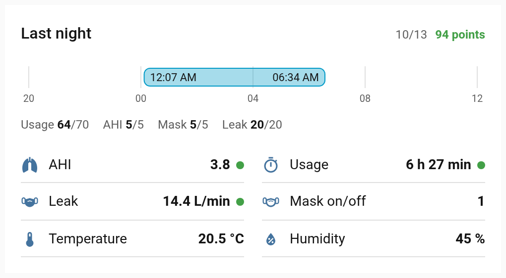
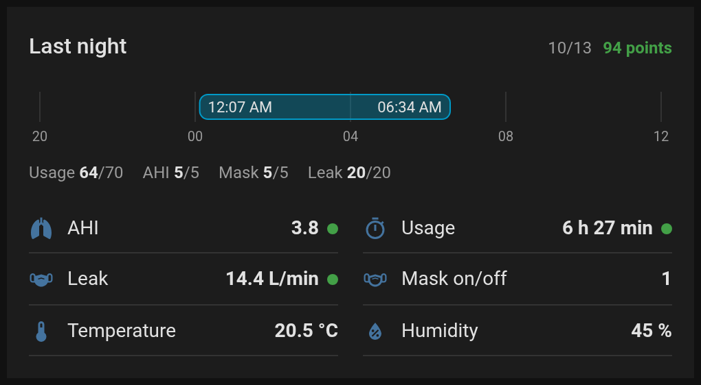
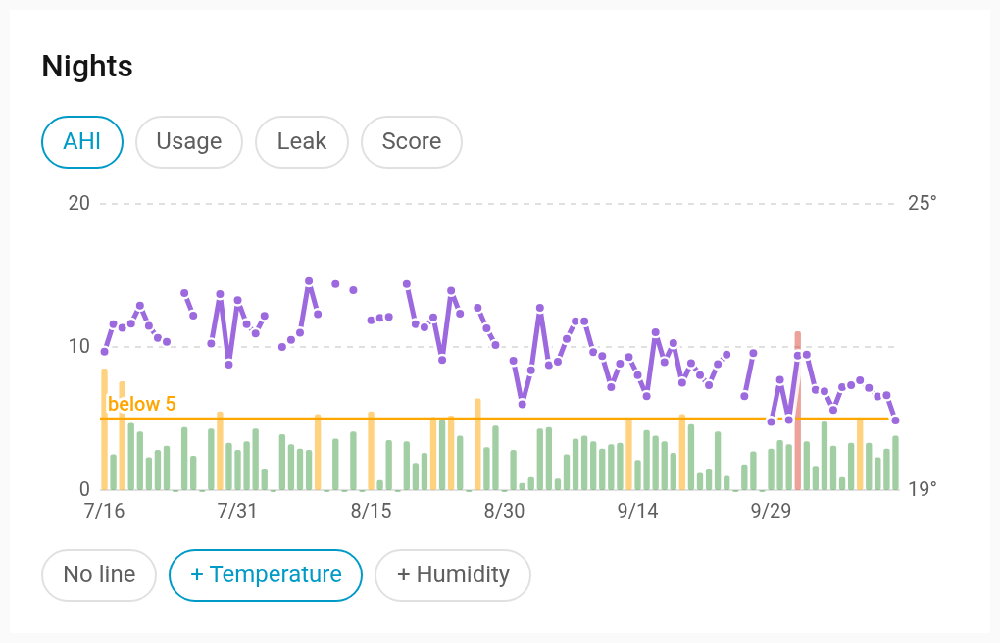
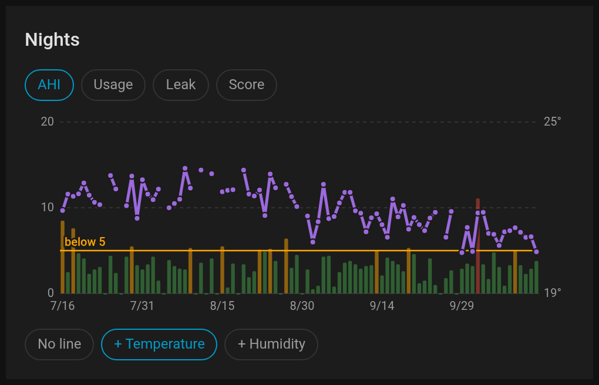

# ResMed myAir Sleep

Home Assistant integration that reads a ResMed CPAP's nights from myAir and keeps every night, with the bedroom's
temperature and humidity over the night's session.

[![GitHub Release][releases-shield]][releases] [![GitHub Release Date][release-date-shield]][releases] [![Downloads][downloads-shield]][releases] [![Marketplace][marketplace-shield]][marketplace] [![License][license-shield]](LICENSE)


## What is it?

A ResMed CPAP, such as an AirSense 10 or 11, uploads each night to ResMed's myAir service, and the myAir app shows the
night's usage, AHI, mask leak and sleep score. This integration logs in to the same account and brings those nights
into Home Assistant.

A night in myAir has no start or end time. The integration keeps every night it has seen in its own storage, without
a limit, and works out when the night's session was from the machine's uploads.
With a temperature and a humidity sensor chosen for the bedroom, it also keeps their average, lowest and highest
values over each night's session, read from Home Assistant's recorder, so the room's conditions can be compared with
how the nights went.

The sensors show the latest night. The integration comes with a dashboard card that draws the stored nights, with
last night, the nights over weeks and months, and AHI against the bedroom's temperature or humidity.

## Installation

### With the Marketplace

1. Open Settings › Marketplace, choose Add from link and paste `https://github.com/jesmak/resmed_myair_sleep`
2. Open ResMed myAir Sleep in the Marketplace and choose Install
3. Restart Home Assistant
4. In Settings, open Devices & services, add an integration and choose ResMed myAir Sleep

### Manual

1. Copy `custom_components/resmed_myair_sleep` from the source code of the [latest release][releases] to the
   `config/custom_components` folder of your Home Assistant installation
2. Restart Home Assistant
3. In Settings, open Devices & services, add an integration and choose ResMed myAir Sleep

## Settings

Setup asks for the account, then for the code ResMed emails to it, then for the bedroom's sensors.

| Name        | Type   | Description                                                                                         | Default  |
| ----------- | ------ | --------------------------------------------------------------------------------------------------- | -------- |
| Email       | text   | The account you sign in to the myAir app with                                                       | required |
| Password    | text   | The account's password                                                                              | required |
| Region      | select | Europe for an account made at myair.resmed.eu, North America for one made at myair.resmed.com       | Europe   |
| Code        | text   | The verification code ResMed sends to the account's email during setup                              | required |
| Temperature | entity | A temperature sensor in the bedroom. Its average, lowest and highest value are kept with each night | none     |
| Humidity    | entity | A humidity sensor in the bedroom. Its average is kept with each night                               | none     |

The sensors can be changed later from the integration's options. A change applies to the nights to come. If myAir
stops accepting the login, Home Assistant asks for the password again.

The integration polls myAir every 30 minutes. Its first poll brings every night myAir gives for the current and the
previous month.

## Sensors

The sensors are on a device named after the machine, such as AirSense 11 AutoSet, and show its latest night.

| Sensor              | Unit  | Description                                                                                        |
| ------------------- | ----- | -------------------------------------------------------------------------------------------------- |
| Night               | date  | The night's date. A night that starts after midnight still has the previous day's date             |
| Sleep start         | time  | When the session started                                                                           |
| Sleep end           | time  | When the session ended                                                                             |
| Usage               | h     | How long the machine was used                                                                      |
| AHI                 |       | Apnea–hypopnea index, events per hour                                                              |
| Mask leak           | L/min | The mask's leak as myAir reports it, its leak percentile                                           |
| Mask on/off         |       | How many times the mask was put on and taken off                                                   |
| Sleep score         |       | myAir's score for the night, out of 100                                                            |
| Usage score         |       | The part of the score from usage, out of 70                                                        |
| AHI score           |       | The part from AHI, out of 5                                                                        |
| Mask score          |       | The part from putting the mask on and off, out of 5                                                |
| Leak score          |       | The part from the mask's leak, out of 20                                                           |
| Temperature         | °C    | The bedroom's time-weighted average temperature over the session, when a temperature sensor is set |
| Lowest temperature  | °C    | The lowest temperature over the session                                                            |
| Highest temperature | °C    | The highest temperature over the session                                                           |
| Humidity            | %     | The bedroom's time-weighted average humidity over the session, when a humidity sensor is set       |
| Compliance, 30 days | %     | The share of the last 30 nights with at least 4 hours of use                                       |
| Last upload         | time  | When the machine last uploaded to myAir                                                            |

The temperatures are in the unit of the chosen sensor.

### The session and the room's conditions

A myAir night has no start or end time. The machine uploads to myAir when the mask comes off, so the integration sets
the newest night's start as the machine's last upload minus the night's usage, and its end as the start plus the
usage. Time with the mask off in the middle of the night isn't counted, so after a break the start comes out later than
it really was. A start is set only from an upload on the night's date or the next day, so the nights from before the
integration was set up have no session.

When a night's session is set or its usage grows, the integration reads the recorder's history of the bedroom's
sensors over the session and keeps the result with the night. The recorder keeps 10 days by default, so a night
imported later than that gets no conditions.

## Actions

| Action                             | Description                                     |
| ---------------------------------- | ----------------------------------------------- |
| `resmed_myair_sleep.import_nights` | Adds nights kept elsewhere to the stored nights |

It takes `config_entry_id`, the integration's entry, and `nights`, a list of nights, each with its `date` and any of
the fields a stored night has (below). A value already stored is never replaced. When a night gets a start and usage
but no end, its end is set as the start plus the usage. When it gets a session but no room's conditions, they are read
from the recorder, as for the nights myAir gives. Times need their UTC offset. The action returns
`nights_changed`, the number of nights it added to or changed.

```yaml
action: resmed_myair_sleep.import_nights
data:
  config_entry_id: 01JEXAMPLE0000000000000000
  nights:
    - date: "2026-02-03"
      start: "2026-02-03T23:12:00+02:00"
      usage_minutes: 412
      ahi: 2.1
```

## The stored nights

Each stored night has its `date` and the fields it has data for:

| Field                                                           | Description                                                              |
| --------------------------------------------------------------- | ------------------------------------------------------------------------ |
| `start`, `end`                                                  | The session's start and end, as ISO times                                |
| `usage_minutes`                                                 | Usage in minutes                                                         |
| `ahi`, `leak`, `mask_pairs`                                     | AHI, mask leak in L/min, and the times the mask was put on and taken off |
| `score`, `usage_score`, `ahi_score`, `mask_score`, `leak_score` | The sleep score and its parts                                            |
| `temperature`, `temperature_min`, `temperature_max`             | The bedroom's average, lowest and highest temperature over the session   |
| `humidity`, `humidity_min`, `humidity_max`                      | The bedroom's average, lowest and highest humidity over the session      |
| `temperature_readings`, `humidity_readings`                     | How many readings each was computed from                                 |

A card gets them over the websocket with `{"type": "resmed_myair_sleep/nights", "entity_id": "<sensor>"}`, where the
sensor is any of the machine's sensors. It answers `{"nights": [...]}`, oldest first.

## Sleep card

<p>




</p>

The integration comes with a dashboard card for one machine, with three views to choose from.

- **Last night** shows the newest night the machine was used. The session is a bar on the night from 20:00 to noon,
  under it the sleep score's parts, and then the night's AHI, usage, mask leak, mask on/off and the bedroom's
  temperature and humidity. A dot beside AHI, usage and leak tells whether the value is within its limit.
- **The nights** shows the nights of the last `days` days. They can be drawn as bars of one
  figure, with a line of the bedroom's temperature or humidity over them, as four small charts of AHI, usage, leak and
  the score, or as a calendar coloured by one figure, with the 30-day compliance at the top.
- **Sleep and the room** shows how AHI goes with the bedroom's temperature or humidity over the nights that have them.
  It can be drawn as the average AHI for each degree or each 5 % of humidity, or as a dot for each night, coloured by
  its mask leak.

A night with no use, or no data at all, counts as unused. The colours follow the limits. AHI is good below
`ahi_limit`, high from it and bad from twice it. Leak is good below `leak_limit` and bad from 5/3 of
it. Usage is good from `usage_hours` and bad at zero. The score is good from 80 and high from 60.

The chips on the card switch the figure, the line or the room for the moment, without changing the card's options.

The card asks the integration for the stored nights, so it shows every night, not only what the recorder has kept.
The integration serves the card itself and adds it to the dashboards' resources when it starts, so the card is always
the integration's own version. With the resources set in YAML (`resource_mode: yaml`), it can't add or update itself,
and the log says which line to add, change or remove.

### Card options

The card has a visual editor. Add **ResMed myAir Sleep** from the card picker and choose any of the machine's sensors.
The options can also be written by hand, and `height_mode`, `height` and `max_height` only by hand. In a sections view
the layout tab sets the card's height. They are for where there is no layout tab, such as a masonry or panel view, or a
stack or other card the card is inside, even in a sections view.

| Name           | Type   | Description                                                                                                                                                                                                                                                                                                                | Default                                                                         |
| -------------- | ------ | -------------------------------------------------------------------------------------------------------------------------------------------------------------------------------------------------------------------------------------------------------------------------------------------------------------------------- | ------------------------------------------------------------------------------- |
| `type`         | string | `custom:resmed-myair-sleep-card`                                                                                                                                                                                                                                                                                           | required                                                                        |
| `entity`       | string | Any of the machine's sensors                                                                                                                                                                                                                                                                                               | required                                                                        |
| `view`         | string | `last_night`, `nights` or `room`                                                                                                                                                                                                                                                                                           | `last_night`                                                                    |
| `nights_chart` | string | How `nights` is drawn. `bars`, `charts` for the four small charts, or `calendar`                                                                                                                                                                                                                                           | `bars`                                                                          |
| `metric`       | string | The figure the bars and the calendar show first. `ahi`, `usage`, `leak` or `score`                                                                                                                                                                                                                                         | `ahi`                                                                           |
| `room_line`    | string | The line over the bars. `temperature`, `humidity` or `none`                                                                                                                                                                                                                                                                | `temperature`                                                                   |
| `room_chart`   | string | How `room` is drawn. `bins` for the average AHI by range, or `scatter` for a dot per night                                                                                                                                                                                                                                 | `bins`                                                                          |
| `room`         | string | What `room` shows first. `temperature` or `humidity`                                                                                                                                                                                                                                                                       | `temperature`                                                                   |
| `days`         | number | How many days back `nights` and `room` reach, from 7 to 3650                                                                                                                                                                                                                                                               | `90`                                                                            |
| `ahi_limit`    | number | The AHI below which a night is good                                                                                                                                                                                                                                                                                        | `5`                                                                             |
| `leak_limit`   | number | The mask leak in L/min below which a night is good                                                                                                                                                                                                                                                                         | `24`                                                                            |
| `usage_hours`  | number | The hours of use from which a night is good, and which the compliance counts                                                                                                                                                                                                                                               | `4`                                                                             |
| `height_mode`  | string | How tall the card is. `auto` fits its content, `fixed` keeps it at `height`, `max` lets it grow up to `max_height`. A height in grid rows, set in the layout tab of a sections view, is used instead                                                                                                                       | `fixed` when `height` is set, `max` when only `max_height` is, otherwise `auto` |
| `height`       | number | The card's height in pixels, for `fixed`                                                                                                                                                                                                                                                                                   |                                                                                 |
| `max_height`   | number | The card's greatest height in pixels, for `max`                                                                                                                                                                                                                                                                            |                                                                                 |
| `row_step`     | string | How the card rounds its height on automatic rows in a sections view, with `height_mode` `auto` or `max`. `full` rounds it up to whole rows, so the cards under it stay on the rows. `half` rounds it up to half rows, which saves space but can leave the cards under it half a row off the rows of the sections beside it | `full`                                                                          |

### Sizes

In a sections view the card is the section's full width by default, and can be made as narrow as 6 columns. On
automatic rows it ends on whole rows, or on half rows with `row_step: half`, and a chart takes the room left over. Room
a chart gets beyond its own height first widens its gaps to the parts above and below it, by up to 20 px each, and the
chart grows by the rest. The same goes for a card held taller than its content.

Held lower than its content needs, a chart shrinks down to 90 px, and the small charts down to 40 px each. The rows of
last night, the room's ranges and the calendar scroll instead, and the calendar opens on its newest month. Each view
has its least height, which the card doesn't go below.

## Examples

A sections view of two sections. One has last night and the nights' AHI with the bedroom's humidity over the bars,
the other a calendar of 180 days and a dot for each night against the bedroom's temperature.

```yaml
type: sections
max_columns: 2
sections:
  - type: grid
    cards:
      - type: custom:resmed-myair-sleep-card
        entity: sensor.airsense_11_autoset_ahi
      - type: custom:resmed-myair-sleep-card
        entity: sensor.airsense_11_autoset_ahi
        view: nights
        room_line: humidity
  - type: grid
    cards:
      - type: custom:resmed-myair-sleep-card
        entity: sensor.airsense_11_autoset_ahi
        view: nights
        nights_chart: calendar
        days: 180
      - type: custom:resmed-myair-sleep-card
        entity: sensor.airsense_11_autoset_ahi
        view: room
        room_chart: scatter
```

## Data

The nights come from ResMed's myAir, from the same service the myAir app uses, and the room's conditions from your own
sensors in Home Assistant's recorder.

This is an unofficial integration. It isn't affiliated with or endorsed by ResMed. Each user logs in with their own
myAir account, and using it may be against ResMed's terms of service, so use it at your own risk. It will be withdrawn
if ResMed objects. The figures are myAir's and are not medical advice.

## Translating

The integration's texts are in `custom_components/resmed_myair_sleep/translations/`, one JSON file per language, named
by its language code, such as `en.json` and `fi.json`. To add a language, copy `en.json` to the new language's code
and translate the values.

The card's texts are in `frontend/src/localize/languages/`, in the same way. The card finds a new file by itself and
uses it when Home Assistant is set to that language. A text left out falls back to English.

## Development

Requires Python 3.14, the version the current Home Assistant needs.

```
python3.14 -m venv .venv
.venv/bin/pip install -r requirements_test.txt
.venv/bin/ruff check . && .venv/bin/ruff format --check . && .venv/bin/pytest
```

The card is in `frontend/` and requires Node 22.13 or newer:

```
cd frontend
npm install
npm run check
```

`npm run check` typechecks, lints, checks formatting, runs the tests and builds
`custom_components/resmed_myair_sleep/www/resmed-myair-sleep-card.js`, which is the file the integration serves and is
committed to the repository. The card carries the integration's version from `manifest.json`. To have git refuse a
commit whose built card doesn't match `frontend/`, run `git config core.hooksPath .githooks` once.

| Path                                                  | What it contains                                                                            |
| ----------------------------------------------------- | ------------------------------------------------------------------------------------------- |
| `custom_components/resmed_myair_sleep/client/`        | The myAir client, with the login by the emailed code and the GraphQL queries                |
| `custom_components/resmed_myair_sleep/nights.py`      | The stored nights, with merging myAir's records, the session, the conditions and compliance |
| `custom_components/resmed_myair_sleep/coordinator.py` | Polling myAir, the storage, and reading the room's conditions from the recorder             |
| `custom_components/resmed_myair_sleep/sensor.py`      | The sensors                                                                                 |
| `custom_components/resmed_myair_sleep/__init__.py`    | Setting up, the action and the websocket command                                            |
| `custom_components/resmed_myair_sleep/card.py`        | Serving the card and keeping its dashboard resource                                         |
| `frontend/src/`                                       | The card: its views, charts, data, editor and texts                                         |
| `tests/`                                              | Tests, run with pytest and a mocked myAir                                                   |

## Support

Hey dude! Help me out for a couple of :beers: or a :coffee:!

[](https://www.buymeacoffee.com/jesmak)

## Thanks

The myAir client started from [resmed_myair_sensors](https://github.com/prestomation/resmed_myair_sensors), whose MIT
licence and copyright are kept in [LICENSE](LICENSE).

## License

MIT, see [LICENSE](LICENSE).

[releases-shield]: https://img.shields.io/github/release/jesmak/resmed_myair_sleep.svg?style=for-the-badge
[release-date-shield]: https://img.shields.io/github/release-date/jesmak/resmed_myair_sleep?style=for-the-badge
[releases]: https://github.com/jesmak/resmed_myair_sleep/releases
[downloads-shield]: https://img.shields.io/github/downloads/jesmak/resmed_myair_sleep/total.svg?style=for-the-badge
[marketplace-shield]: https://img.shields.io/badge/Marketplace-Custom-orange.svg?style=for-the-badge
[marketplace]: https://my.home-assistant.io/redirect/marketplace_repository/?owner=jesmak&repository=resmed_myair_sleep&category=integration
[license-shield]: https://img.shields.io/github/license/jesmak/resmed_myair_sleep.svg?style=for-the-badge
